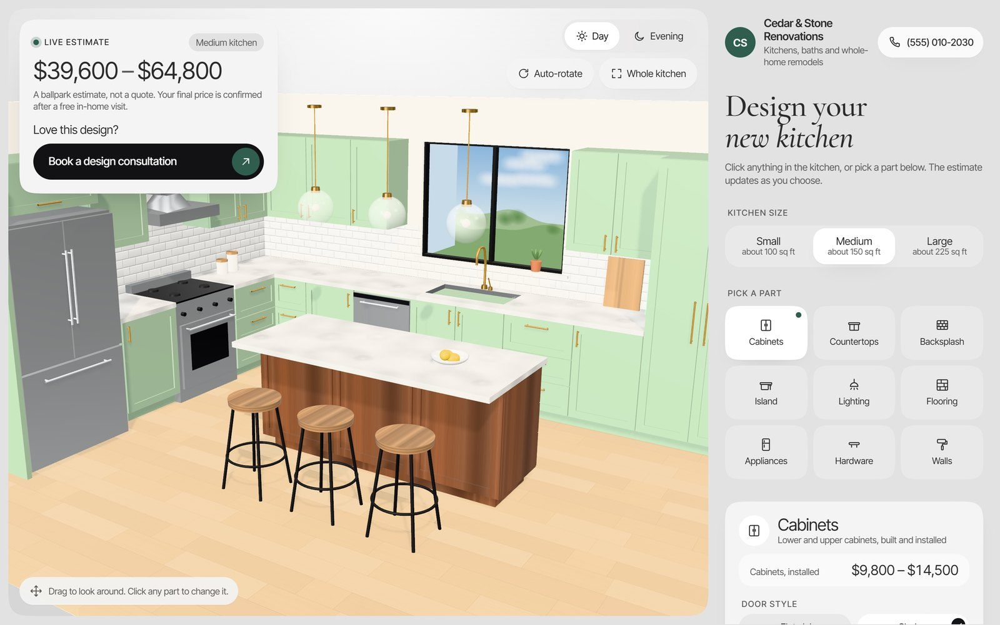

# Renovation Estimator

A 3D kitchen you can redesign in the browser. Click any part (cabinets, counters, backsplash, island, lighting,
flooring, appliances, hardware, walls), pick a finish, and a live price range updates as you choose. It's built as
a website feature for renovation companies: visitors see a realistic range before they book a consultation.

**Live:** https://renovation-estimator-orpin.vercel.app



## How it's built

- **three.js**, with the whole kitchen built in code, no model files (`src/rooms/kitchen.js`, `src/engine/`).
  Procedural textures, day and evening lighting, click-to-select on any part.
- **One config file per business** (`src/business.config.js`): name, contact, parts, options and price ranges.
  Re-skinning it for a new company means editing that one file.
- Plain JavaScript and CSS, built with Vite.

The prices are placeholder mid-range US numbers, and only the kitchen exists so far.

## Running it

```bash
npm install
npm run dev
```
